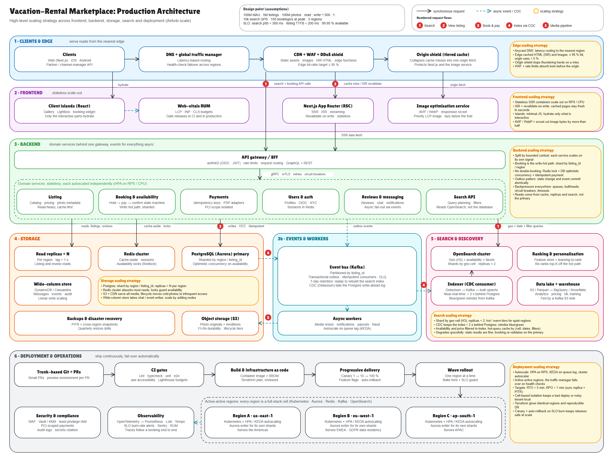

# Production architecture: vacation-rental marketplace

Editable source: [`architecture-diagram.excalidraw`](architecture-diagram.excalidraw) (open at excalidraw.com). Vector export: [`architecture-diagram.svg`](architecture-diagram.svg). Regenerate all three with `node scripts/architecture/build-diagram.mjs`.

## 1. Design point

| Dimension | Assumption |
| --- | --- |
| Users | 100M monthly active, global |
| Inventory | 5M listings, 100M photos |
| Traffic shape | Read : write ≈ 500 : 1 (browse and search dominate; bookings are rare but must be correct) |
| Peak load | 10k search QPS, 150 bookings/s |
| Regions | 3 active-active (Americas, EMEA, APAC) |
| SLOs | Search p95 < 300 ms, listing TTFB < 200 ms, 99.95 % availability, RTO < 5 min, RPO < 1 min |

The core insight: this is a read-heavy system with one small, strongly consistent write path (booking). Everything in the design either keeps reads off the primary database or protects the booking path.

## 2. Scaling strategy by area

### Frontend (Next.js App Router)
- **Stateless SSR containers** behind the CDN, scaled out on RPS/CPU (HPA). No session affinity.
- **ISR + revalidate-on-write:** listing pages are cached at the edge and refreshed within seconds of a host edit. The CDN serves stale-while-revalidate, and a listing edit triggers tag-based on-demand revalidation of just that page. The origin only sees misses.
- **Islands:** the page is server-rendered; only the gallery, lightbox and booking widget hydrate, keeping the JS budget small.
- **Images:** an optimisation service emits AVIF/WebP with responsive `srcset`; the LCP image is prioritised, the rest lazy-load. This is the bulk of the bytes, so it is served entirely from the CDN.
- **RUM** tracks LCP/INP/CLS and gates releases.

### Edge
- Latency-based DNS routes each user to the nearest healthy region and fails over on health checks.
- CDN + WAF + DDoS shield (for example Cloudflare or CloudFront) absorb bots and rate-limit before the origin. Target edge hit ratio ≥ 95 %.
- A tiered cache / origin shield collapses concurrent misses into one origin fetch (no thundering herd).

### Backend
- One **API gateway / BFF** (authN/Z, sliding-window rate limits, routing) in front of stateless domain services split by bounded context: Listing, Booking & availability, Payments, Users & auth, Reviews & messaging, Search API. Each scales on its own signal.
- **Booking is the write hot path** and is sharded by region / `listing_id`.
- **Async by default:** state changes write an event to a transactional outbox in the same DB transaction, then publish to Kafka. Consumers are idempotent; failures go to a DLQ. Notifications, payouts, media processing and fraud checks run as workers autoscaled on queue lag (KEDA).
- **Resilience:** timeouts, retries with jitter, circuit breakers and bulkheads on every service call (mTLS service mesh).

### Storage
| Store | Used for | Scaling |
| --- | --- | --- |
| PostgreSQL (Aurora) | Source of truth: listings, bookings, payments, users | Shard by region / `listing_id`; synchronous replica for HA; PITR |
| Read replicas | Listing and review reads | × N per region, lag < 1 s |
| Redis cluster | Cache-aside, sessions, availability locks | Hash-slot sharding; absorbs most reads |
| Object storage (S3) | Photo originals and renditions | Effectively unbounded; lifecycle tiers; served through the CDN |
| Wide-column (DynamoDB / Cassandra) | Messages, events, audit | Linear write scaling by adding nodes |
| Data lake + warehouse | Analytics, pricing, ML training | S3/Parquet fed by a Kafka sink |

**Read-your-own-writes:** with replicas in every region, a user's session is pinned to the writer for a short window after they change something (a booking, a listing edit), so they never see their own change missing.

### Search
- **OpenSearch** indexed by geo cell (H3) with availability, price and facets in the index, so a search never touches Postgres.
- **Shards by geo cell**, replicas × 2, hot/warm tiers for quiet regions.
- **CDC (Debezium) → Kafka → indexer** keeps the index < 2 s behind Postgres; a full reindex replays Kafka and cuts over blue/green.
- A **hot-query cache** keyed by (cell, dates, filters) absorbs repeat searches; ranking runs as a separate re-rank of the top-K.
- **Graceful degradation:** stale search results are acceptable because the booking path re-validates against the primary.

### Deployment
- Trunk-based Git, per-PR preview environments, CI gates (lint, typecheck, unit, e2e, axe, Lighthouse budgets).
- Container image + SBOM, Terraform for every region so regions are identical and DR is reproducible.
- **Progressive delivery:** canary 1 → 10 → 100 % with feature flags and automatic rollback on SLO burn; rollouts move one region at a time with bake time.
- **Active-active regions**, each a full-stack cell (Kubernetes, Aurora, Redis, Kafka, OpenSearch). Cells limit blast radius; the traffic manager drains an unhealthy region.
- **Observability:** OpenTelemetry to Prometheus, Loki and Tempo; SLO burn-rate alerts; Sentry; RUM; traces follow a booking end to end.
- **Security:** WAF, Vault/KMS, least-privilege IAM, PCI-scoped payments service, GDPR data residency per region.

## 3. Request flows (numbered on the diagram)

1. **Search:** client → CDN/edge → gateway → Search API → (hot-query cache) → OpenSearch. Postgres is never queried.
2. **View listing:** CDN serves ISR HTML. On a miss (or revalidation) the origin shield calls Next.js, which fetches from the Listing service via replicas and Redis.
3. **Book and pay:** Booking service takes a Redis availability lock, then commits the reservation in Postgres with optimistic concurrency (a version check on the availability rows); Payments uses an idempotency key so retries never double-charge. The outbox row commits in the same transaction.
4. **Index via CDC:** the committed change flows Postgres → Debezium → Kafka → indexer → OpenSearch, so search reflects the booking within about two seconds.
5. **Media pipeline:** host uploads to S3 via a presigned URL → event → media workers create renditions (WebP/AVIF, multi-density thumbnails, blurhash placeholders) → CDN serves them.

## 4. Preventing double-booking

Three layers, so no single failure can oversell a night:
1. **Redis lock (Redlock)** on `(listing, date range)` serialises concurrent attempts cheaply and fails fast.
2. **Optimistic concurrency in Postgres:** the reservation write carries the availability row version; a stale version aborts. This is the source of truth; the lock is only an optimisation and its loss cannot corrupt data.
3. **Idempotent payments:** the client sends an `Idempotency-Key` header, deduplicated in Redis and stored with the reservation, so a retry returns the original result instead of charging twice.

The reservation itself is a small state machine, so a half-finished booking can never hold dates forever:

`Pending` → `Reserved` (dates held with a TTL) → `Payment authorized` → `Confirmed`

If payment fails or the hold TTL expires, a compensating step releases the dates (saga). Only `Confirmed` writes the final availability change, and it publishes the outbox event that updates search.

## 5. Failure modes

| Failure | Behaviour |
| --- | --- |
| Region outage | Traffic manager drains it; other regions serve. Bookings for shards homed there fail over to the synchronous replica (RPO < 1 min). |
| Redis down | Locks are unavailable, so Booking falls back to DB-only concurrency (slower, still correct); reads hit replicas. |
| Kafka lag | Search results go stale; bookings and reads are unaffected. Alert on lag; replay to catch up. |
| OpenSearch down | Serve cached results, then a degraded replica-backed search for the top cities. |
| Bad deploy | Canary catches it at 1 %; automatic rollback on SLO burn. |

## 6. Key trade-offs

- **Search is eventually consistent, booking is strongly consistent.** Users tolerate a stale result; they do not tolerate a double-booking.
- **Sharding by region / listing** keeps a booking's data on one shard (no distributed transactions) at the cost of harder cross-region analytics, which the warehouse handles.
- **Outbox + CDC over dual writes** costs extra infrastructure but removes the class of bugs where the DB and index disagree.
- **Managed services** (Aurora, OpenSearch Service, MSK) trade cost for operational load; the design is vendor-neutral, and the AWS names are illustrative.
